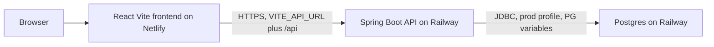

# TaskFlow API — Dockerize & Deploy

Submission write-up for the NTU AI Engineering Module 4 (DevOps) assignment.

This repository is the Spring Boot API. The React frontend is a separate app, deployed on Netlify, and calls this API in production. The sections through [Running locally](#running-locally) describe the application as it is implemented. The DevOps sections after that are placeholders. Each one has a `TODO(Rob)` comment for the pipeline, image tags, Railway service, scan numbers, and the errors we hit. Operator notes for those tools are in [docs/DEVOPS.md](docs/DEVOPS.md). Fold that material into the placeholders.

## Contents

- [Overview](#overview)
- [Architecture](#architecture)
- [Live URLs](#live-urls)
- [API](#api)
- [Spring profiles](#spring-profiles)
- [CORS](#cors)
- [Frontend wiring](#frontend-wiring)
- [Environment variables](#environment-variables)
- [Running locally](#running-locally)
- [CircleCI pipeline](#circleci-pipeline)
- [Docker Hub version tags](#docker-hub-version-tags)
- [Railway setup](#railway-setup)
- [Security scans](#security-scans)
- [Errors hit and fixes](#errors-hit-and-fixes)
- [Stretch goals](#stretch-goals)
- [Screenshots](#screenshots)

## Overview

TaskFlow is a task-management HTTP API. A client creates, lists, reads, updates, and deletes tasks. Each task has a title, an optional description, a status, a priority, and an optional due date.

| Piece | Role |
| --- | --- |
| Java 21, Spring Boot 3.5.16 | API process |
| Spring Web | REST controllers under `/api` |
| Spring Data JPA, Hibernate | Persistence. `ddl-auto` is `update` |
| H2 | In-memory database for the default profile and for `mvn test` |
| PostgreSQL | Database for the `prod` profile on Railway |
| Maven | Build and test. The `pom.xml` version is `0.0.1-SNAPSHOT` |
| Lombok | Entity getters, setters, and constructors |
| React (Vite) | Browser UI, built and hosted on Netlify |
| Docker | Multi-stage image. Build with `maven:3.9-eclipse-temurin-21`, run with `eclipse-temurin:21-jre-alpine` as the user `taskflow` |

The Maven version in `pom.xml` is the project version. Image tags come from the root `VERSION` file (`1.1.0` in this revision). How those tags are published is in [Docker Hub version tags](#docker-hub-version-tags).

A small Bootstrap page is also served by the API from `src/main/resources/static/index.html`. It is a same-origin helper for local runs. The submitted UI is the Netlify app.

## Architecture

The browser loads the React app from Netlify. That build has the API origin baked in. The browser then calls the Spring Boot API on Railway. With `SPRING_PROFILES_ACTIVE=prod`, the API stores tasks in Railway Postgres.



Locally, `mvn spring-boot:run` and `docker run` stay on the default profile. They use in-memory H2 and listen on port 8080. They do not need Postgres.

## Live URLs

| What | URL |
| --- | --- |
| API | https://module3-taskflow-api-production-d562.up.railway.app |
| Example request | https://module3-taskflow-api-production-d562.up.railway.app/api/tasks |
| React frontend | https://module4-task-manager.netlify.app/ |
| Frontend repository | https://github.com/debighosh/task-manager |
| Docker Hub image | [debighosh/taskflow-api](https://hub.docker.com/r/debighosh/taskflow-api) |
| This API repository | https://github.com/debighosh/module3-taskflow-api |

Task routes are under `/api`. The origin has no `/api` suffix. `GET /api/tasks` on the deployed API returns JSON. The deployed API allows browser calls from `https://module4-task-manager.netlify.app`.

## API

Controller: `TaskController` at `/api/tasks`. There is no other resource.

### Task JSON

```json
{
  "id": 2,
  "title": "Draft the API contract",
  "description": "Agree the task JSON fields and the list, create, update, and delete endpoints.",
  "status": "in-progress",
  "priority": "high",
  "dueDate": "2026-10-24"
}
```

| Field | JSON | Required | Notes |
| --- | --- | --- | --- |
| `id` | number | Generated | The database assigns it. A client-supplied `id` on create or update is ignored. |
| `title` | string | Yes | Trimmed. A missing, empty, or blank title returns HTTP 400. |
| `description` | string or null | No | On update, the stored description is replaced with the value in the body. Omitting it clears the stored description. |
| `status` | string | No on input | One of `todo`, `in-progress`, `done`. Omitted or null on create becomes `todo`. Omitted or null on update leaves the stored status. |
| `priority` | string | No on input | One of `low`, `medium`, `high`. Omitted or null on create becomes `medium`. Omitted or null on update leaves the stored priority. |
| `dueDate` | `yyyy-MM-dd` or null | No | On update, a non-null value replaces the stored date. Omitting it, or sending null, leaves the stored date as it is. |

There is no `completed` field. Status carries that meaning.

Wire values and the values stored in the database differ. Jackson accepts and returns the lowercase strings. The columns store the enum names `TODO`, `IN_PROGRESS`, `DONE`, `LOW`, `MEDIUM`, and `HIGH`. Sending the enum name, such as `"TODO"`, is rejected.

### Endpoints

| Method | Path | Success | Failure |
| --- | --- | --- | --- |
| `GET` | `/api/tasks` | 200, JSON array. Empty array when the table is empty. | |
| `GET` | `/api/tasks/{id}` | 200, one task | 404 when the id is missing |
| `POST` | `/api/tasks` | 201, the saved task, including the generated `id` | 400 when the title is blank, or when `status` or `priority` is not one of the values above |
| `PUT` | `/api/tasks/{id}` | 200, the updated task | 404 when the id is missing. 400 for a blank title or a bad `status` or `priority`. |
| `DELETE` | `/api/tasks/{id}` | 204, empty body | 404 when the id is missing |

`GET /api/tasks` has no query parameters. The bundled local page filters titles in the browser after it has loaded the full list.

### Error body

A rejected request uses Spring Boot's default JSON. The body has `timestamp`, `status`, `error`, and `path`. The app does not set `server.error.include-message`, so the reason text is not in the body. The service still raises `Title is required` (400) and `Task not found with id: …` (404).

```json
{
  "timestamp": "2026-10-24T03:39:18.439+00:00",
  "status": 404,
  "error": "Not Found",
  "path": "/api/tasks/999999"
}
```

A blank title or a status outside `todo`, `in-progress`, and `done` looks the same with `"status": 400` and `"error": "Bad Request"`.

### Sample requests (bash)

Use this block in bash, Git Bash, or WSL. In Windows PowerShell, `curl` is an alias of `Invoke-WebRequest`, and a single-quoted JSON body does not survive the paste. PowerShell samples are in the next section.

The mutating examples use localhost so a pasted `DELETE` does not remove a task on the deployed database. Point `BASE` at Railway when you want to call production. Substitute `ID` with the `id` returned by the create call.

```bash
BASE="http://localhost:8080"
# Production: BASE="https://module3-taskflow-api-production-d562.up.railway.app"

curl -sS -w "\nHTTP %{http_code}\n" "$BASE/api/tasks"

curl -sS -w "\nHTTP %{http_code}\n" \
  -X POST "$BASE/api/tasks" \
  -H "Content-Type: application/json" \
  -d '{"title":"Write endpoint documentation","description":"Document each REST endpoint.","status":"todo","priority":"low","dueDate":"2026-11-01"}'

curl -sS -w "\nHTTP %{http_code}\n" "$BASE/api/tasks/ID"

curl -sS -w "\nHTTP %{http_code}\n" \
  -X PUT "$BASE/api/tasks/ID" \
  -H "Content-Type: application/json" \
  -d '{"title":"Write endpoint documentation","description":"Examples are in the README.","status":"done","priority":"medium","dueDate":"2026-11-01"}'

curl -sS -w "\nHTTP %{http_code}\n" \
  -X DELETE "$BASE/api/tasks/ID"

curl -sS -w "\nHTTP %{http_code}\n" \
  -X POST "$BASE/api/tasks" \
  -H "Content-Type: application/json" \
  -d '{"title":"   ","status":"todo","priority":"low"}'

curl -sS -w "\nHTTP %{http_code}\n" "$BASE/api/tasks/999999"
```

After `ID` is replaced with the created task's id, the status codes are 200, 201, 200, 200, 204, 400, and 404.

### Sample requests (PowerShell)

`Invoke-RestMethod` prints the JSON object. A 204 delete prints nothing. Windows PowerShell raises on 400 and 404, so the last two calls are wrapped.

```powershell
$Base = "http://localhost:8080"
# Production: $Base = "https://module3-taskflow-api-production-d562.up.railway.app"

Invoke-RestMethod -Uri "$Base/api/tasks" -Method Get

$createBody = @'
{
  "title": "Write endpoint documentation",
  "description": "Document each REST endpoint.",
  "status": "todo",
  "priority": "low",
  "dueDate": "2026-11-01"
}
'@

$created = Invoke-RestMethod -Uri "$Base/api/tasks" -Method Post -ContentType "application/json" -Body $createBody
$created

Invoke-RestMethod -Uri "$Base/api/tasks/$($created.id)" -Method Get

$updateBody = @'
{
  "title": "Write endpoint documentation",
  "description": "Examples are in the README.",
  "status": "done",
  "priority": "medium",
  "dueDate": "2026-11-01"
}
'@

Invoke-RestMethod -Uri "$Base/api/tasks/$($created.id)" -Method Put -ContentType "application/json" -Body $updateBody

Invoke-RestMethod -Uri "$Base/api/tasks/$($created.id)" -Method Delete

$badTitle = '{"title":"   ","status":"todo","priority":"low"}'
try {
  Invoke-RestMethod -Uri "$Base/api/tasks" -Method Post -ContentType "application/json" -Body $badTitle
} catch {
  $_.Exception.Message
}

try {
  Invoke-RestMethod -Uri "$Base/api/tasks/999999" -Method Get
} catch {
  $_.Exception.Message
}
```

## Spring profiles

The default profile is for local development and tests. `application.properties` is always loaded. `SPRING_PROFILES_ACTIVE=prod` also loads `application-prod.properties`.

### Default profile (H2)

| Setting | Value |
| --- | --- |
| JDBC URL | `jdbc:h2:mem:taskflowdb` |
| Driver | `org.h2.Driver` |
| User | `sa` |
| Password | empty |
| DDL | `update` |
| SQL logging | on |
| H2 console | enabled at `/h2-console` |
| Port | `PORT` when it is set, otherwise 8080 |

The database is in memory, so it is empty every time the process starts. `TaskDataSeeder` then inserts six tasks when the `tasks` table has no rows. Stopping the app clears them. The next start inserts them again.

| Title | Status | Priority | Due date |
| --- | --- | --- | --- |
| Set up the project repository | `done` | `high` | 2026-10-20 |
| Draft the API contract | `in-progress` | `high` | 2026-10-24 |
| Design the task board layout | `in-progress` | `medium` | 2026-10-28 |
| Write endpoint documentation | `todo` | `low` | null |
| Add email reminders | `todo` | `medium` | 2026-11-05 |
| Support drag and drop ordering | `todo` | `low` | null |

`mvn test` uses this profile. The tests do not start Postgres and they do not set `SPRING_PROFILES_ACTIVE`.

### Prod profile (Railway Postgres)

Activate it with `SPRING_PROFILES_ACTIVE=prod`.

Railway's `DATABASE_URL` is a `postgres://` URL, which JDBC cannot use. `application-prod.properties` builds the JDBC URL from the Postgres plugin variables:

```properties
spring.datasource.url=jdbc:postgresql://${PGHOST}:${PGPORT}/${PGDATABASE}
spring.datasource.username=${PGUSER}
spring.datasource.password=${PGPASSWORD}
spring.datasource.driverClassName=org.postgresql.Driver
```

The variable names are `PGHOST`, `PGPORT`, `PGDATABASE`, `PGUSER`, and `PGPASSWORD`. SQL logging is off. The H2 console is off. `ddl-auto` stays `update`, so Hibernate creates or updates the `tasks` table on an empty database.

The same seeder runs in prod. It inserts the six tasks only when the table is empty. A Postgres volume keeps its rows, so a restart does not insert them again.

No Hibernate dialect is hard-coded. Hibernate selects H2 in the default profile and PostgreSQL in prod.

## CORS

`CorsConfig` allows browser calls to `/api/**`. The origin list is `app.cors.allowed-origins`, which reads the environment variable `ALLOWED_ORIGINS`. The name is case-sensitive. The value is comma-separated. Each entry is trimmed, and empty entries are dropped.

Allowed methods are `GET`, `POST`, `PUT`, `DELETE`, and `OPTIONS`. Allowed headers are `*`. Browsers send an `OPTIONS` preflight before a cross-origin `PUT` or `DELETE`.

When `ALLOWED_ORIGINS` is unset, the only allowed origin is `http://localhost:5173` (the Vite dev server). The deployed API allows `https://module4-task-manager.netlify.app`. The value must match the browser `Origin` header: scheme, host, and port, with no path and no trailing slash.

The bundled page at `http://localhost:8080` is same-origin, so it does not use this CORS list.

## Frontend wiring

The React app lives in [debighosh/task-manager](https://github.com/debighosh/task-manager) and is deployed at https://module4-task-manager.netlify.app/.

`VITE_API_URL` is set on Netlify at build time. Vite inlines it into the static bundle. Set it to the API origin only, with no `/api` suffix:

```text
https://module3-taskflow-api-production-d562.up.railway.app
```

The client calls `/api/tasks` on that origin (`GET`, `POST`, `PUT`, and `DELETE`). Changing the variable requires a new Netlify build. A restart of the API does not change a bundle that was already published.

The current Netlify bundle contains that Railway origin. An empty value in the client falls back to `http://localhost:8080`.

## Environment variables

No secret values belong in this repository. Examples below are either public origins or names of references, not passwords or tokens.

| Name | Purpose | Example | Where it is set |
| --- | --- | --- | --- |
| `SPRING_PROFILES_ACTIVE` | Loads `application-prod.properties` | `prod` | Railway API service |
| `ALLOWED_ORIGINS` | Comma-separated browser origins for `/api/**`. Case-sensitive name. | `https://module4-task-manager.netlify.app` | Railway API service |
| `PGHOST` | Postgres host. Used in the JDBC URL. | Railway variable reference to the Postgres service | Railway API service |
| `PGPORT` | Postgres port | Railway variable reference to the Postgres service | Railway API service |
| `PGDATABASE` | Database name | Railway variable reference to the Postgres service | Railway API service |
| `PGUSER` | Database user | Railway variable reference to the Postgres service | Railway API service |
| `PGPASSWORD` | Database password | Railway variable reference to the Postgres service. Secret. | Railway API service |
| `PORT` | HTTP port. Unset means 8080. | Railway sets this on the API service | Railway API service |
| `VITE_API_URL` | API origin baked into the React build. No `/api` suffix. | `https://module3-taskflow-api-production-d562.up.railway.app` | Netlify, build environment |
| `DOCKERHUB_USERNAME` | Namespace for the published image | `debighosh` | CircleCI project environment |
| `DOCKERHUB_TOKEN` | Docker Hub access token used to push | Stored only in CircleCI | CircleCI project environment |
| `NVD_API_KEY` | Optional. A blank or unset value skips OWASP Dependency-Check. | Unset, or a key stored only in CircleCI | CircleCI project environment |
| `APP_VERSION` | Docker build argument. Recorded as an OCI image label. Omitted means `unversioned`. | `1.1.0` | `docker build --build-arg`, and CircleCI |

`APP_VERSION` is a build argument, not a Spring property. Local H2 credentials (`sa` and an empty password) are in `application.properties`. They are not environment variables.

## Running locally

### Prerequisites

- JDK 21
- Maven 3.6 or later
- Docker, when you want to run the image

```bash
java -version
mvn -version
```

### API with Maven

From the repository root:

```bash
mvn spring-boot:run
```

The API listens at http://localhost:8080. On a fresh start, `GET http://localhost:8080/api/tasks` returns the six seed tasks. The H2 console is at http://localhost:8080/h2-console (`jdbc:h2:mem:taskflowdb`, user `sa`, empty password).

### Tests

```bash
mvn test
```

CircleCI runs `mvn -B test` (batch mode, same tests). The suite uses H2. It covers list, get, create, update, delete, a missing id (404), a blank title (400), and a CORS preflight from `http://localhost:5173`.

### Docker

The Dockerfile is a multi-stage build. Maven downloads dependencies before `src/` is copied, then packages the JAR with tests skipped. The runtime image copies that JAR, runs as the non-root user `taskflow`, and exposes port 8080. With `PORT` unset, the app listens on 8080.

```bash
docker build --build-arg APP_VERSION=1.1.0 -t taskflow-api:local .
docker run --rm -p 8080:8080 taskflow-api:local
```

In another shell:

```bash
curl -sS http://localhost:8080/api/tasks
```

This container uses the default profile and in-memory H2. It does not need `SPRING_PROFILES_ACTIVE` or Postgres. Stop it with Ctrl+C, or `docker stop` if you started it detached.

Publishing `debighosh/taskflow-api` is described under [Docker Hub version tags](#docker-hub-version-tags).

### Bundled page

http://localhost:8080 serves `src/main/resources/static/index.html` (Bootstrap 5). From that page you can:

1. Create a task. The form posts to `POST /api/tasks` with title, description, priority, due date, and status.
2. Reload the list with `GET /api/tasks`.
3. Filter the loaded list by title in the browser.
4. Open one task. The page calls `GET /api/tasks/{id}`.

That page does not call `PUT` or `DELETE`. Use the samples above, or the Netlify app, to update and delete.

## CircleCI pipeline

<!-- TODO(Rob): CircleCI pipeline. Link the project and a green run on main. Cover workflows ci and release, jobs test, dependency-check, and docker-image, and the DOCKERHUB_* variables. Screenshot: docs/screenshots/circleci-pipeline.png. -->

*Placeholder. Rob replaces this section with the pipeline write-up.*

## Docker Hub version tags

<!-- TODO(Rob): Docker Hub version tags. VERSION drives the tags. A push to main publishes the version from VERSION, sha-<short> (12 hex chars), and latest. 1.0.0 and 1.1.0 both exist on debighosh/taskflow-api. Add digests and docs/screenshots/dockerhub-tags.png. -->

*Placeholder. Rob replaces this section with the tag write-up.*

The file `VERSION` in this revision contains `1.1.0`. The publish rules and the Hub listing belong in the paragraph above.

## Railway setup

<!-- TODO(Rob): Railway setup. Project, GitHub deploy, Postgres, SPRING_PROFILES_ACTIVE, ALLOWED_ORIGINS, PG* references, generated domain https://module3-taskflow-api-production-d562.up.railway.app. Screenshot: docs/screenshots/railway-deploy.png. -->

*Placeholder. Rob replaces this section with the Railway write-up.*

## Security scans

<!-- TODO(Rob): Security scans with before/after numbers for images 1.0.0 and 1.1.0. Trivy on the runtime jars and on the image. OWASP Dependency-Check is skipped when NVD_API_KEY is blank. Screenshot: docs/screenshots/scan-results.png. -->

*Placeholder. Rob replaces this section with the scan numbers.*

## Errors hit and fixes

<!-- TODO(Rob): Errors hit and fixes: NVD API key caused Dependency-Check exit 13; a stale CircleCI run; the Railway GitHub app was not installed; CORS preflight returned 403 until the API was redeployed. -->

*Placeholder. Rob replaces this section with the error log.*

## Stretch goals

| Option | Goal | Status |
| --- | --- | --- |
| 1 | CircleCI builds the image and publishes it to Docker Hub | Configured in `.circleci/config.yml`: test, then build, and publish `debighosh/taskflow-api` from `main`. The live pipeline URL is still the CircleCI placeholder. |
| 2 | React frontend on Netlify, connected to this API | Live at https://module4-task-manager.netlify.app/ with `VITE_API_URL` set to the Railway origin. |
| 4 | Versioned images | `VERSION` is `1.1.0`. A `main` publish tags that version, `sha-` plus a 12-character commit id, and `latest`. Confirmation that `1.0.0` and `1.1.0` are on Docker Hub is still the Docker Hub placeholder. |
| 5 | Security scans | Trivy scans the runtime jars and the image in CI and does not fail the build. OWASP Dependency-Check 13.0.0 is skipped when `NVD_API_KEY` is blank. Before and after counts are still the security scans placeholder. |

## Screenshots

<!-- TODO(Rob): Add the PNG files next to docs/screenshots/.gitkeep. The student may drop the app shots (netlify-app.png, crud-demo.png) on this same branch. Links below are ready. -->

The image files are not in the repository yet. Add them under `docs/screenshots/` with these names. The links are relative and will render on GitHub once the files are committed.

### Railway


### Docker Hub tags


### CircleCI pipeline


### Netlify app


### CRUD demo


### Scan results


