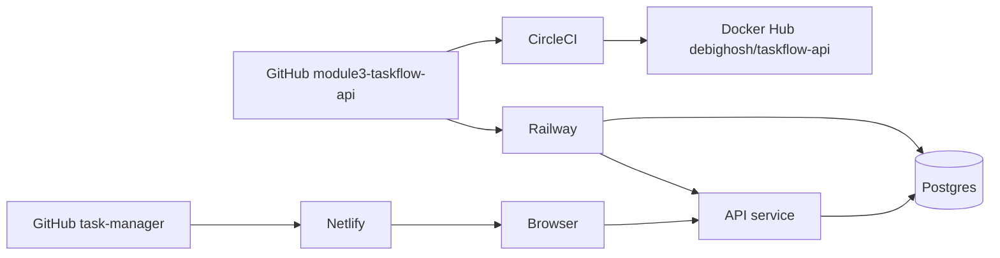
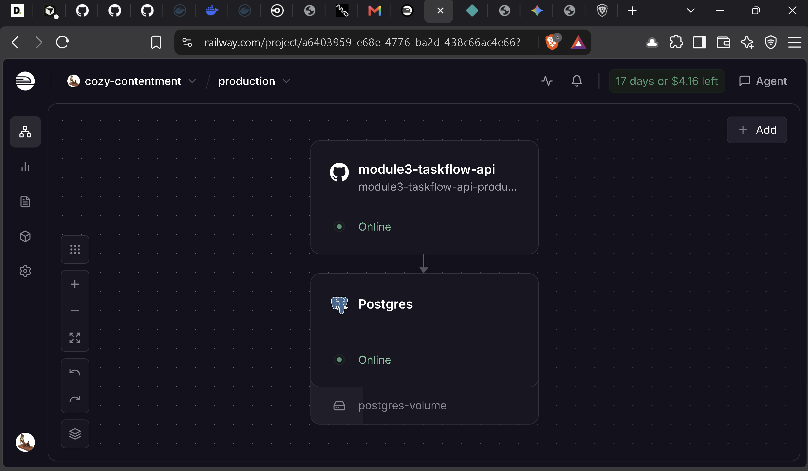
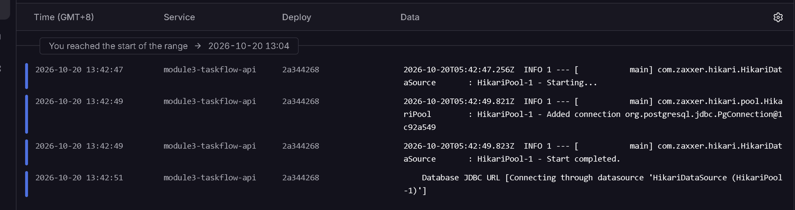
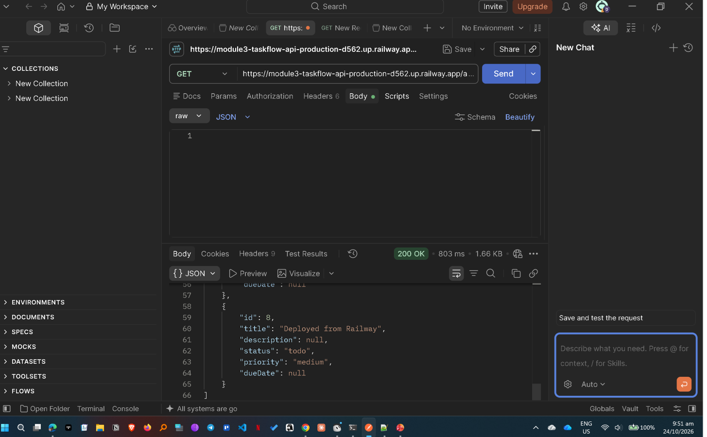
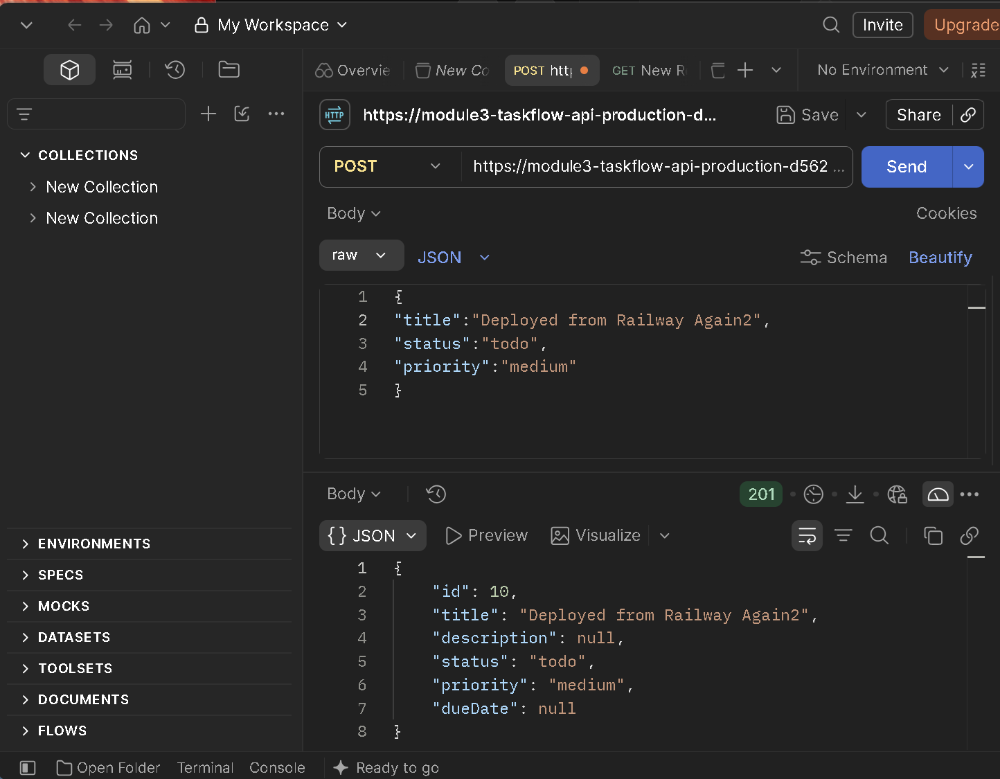
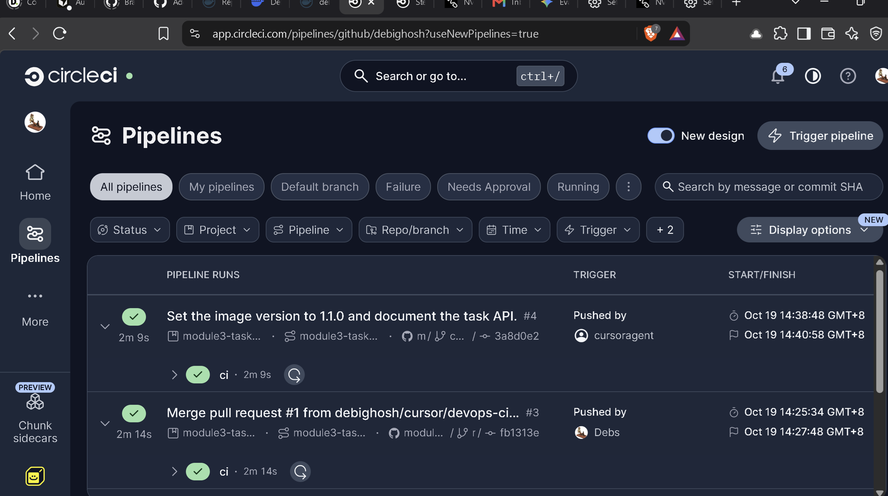
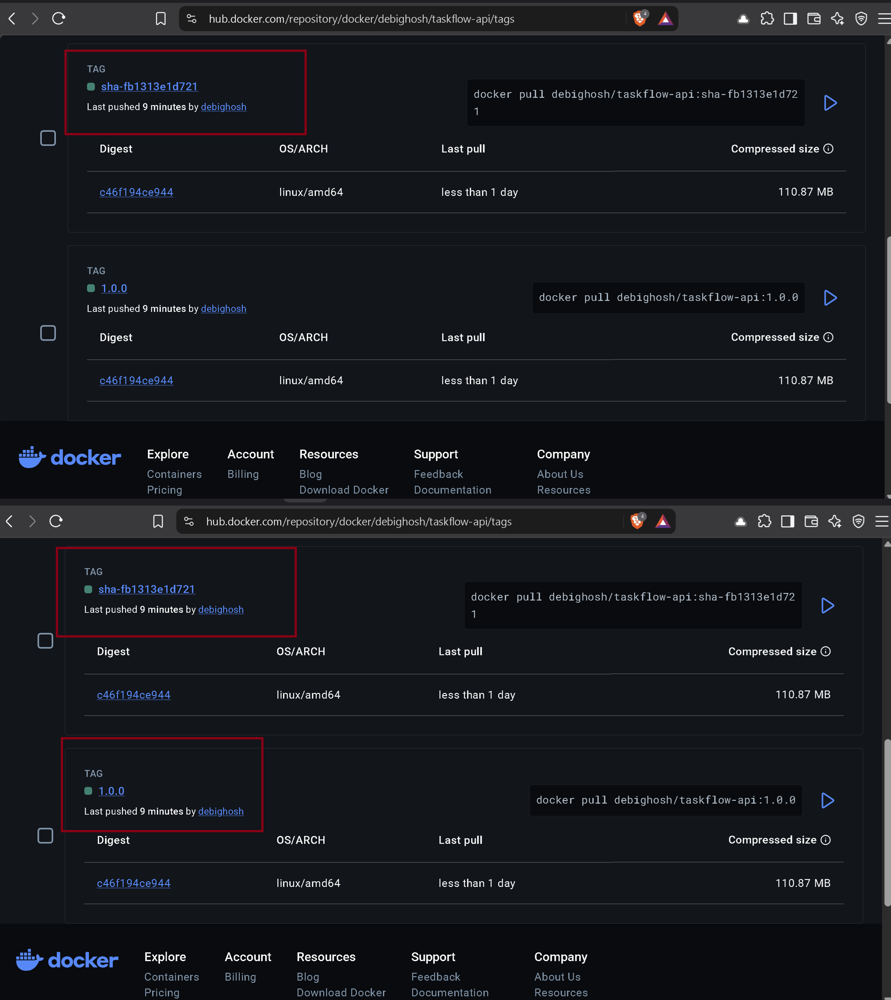
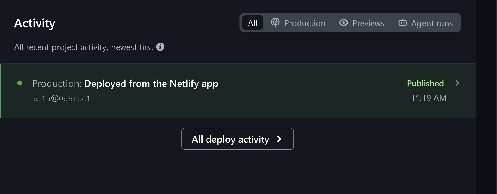
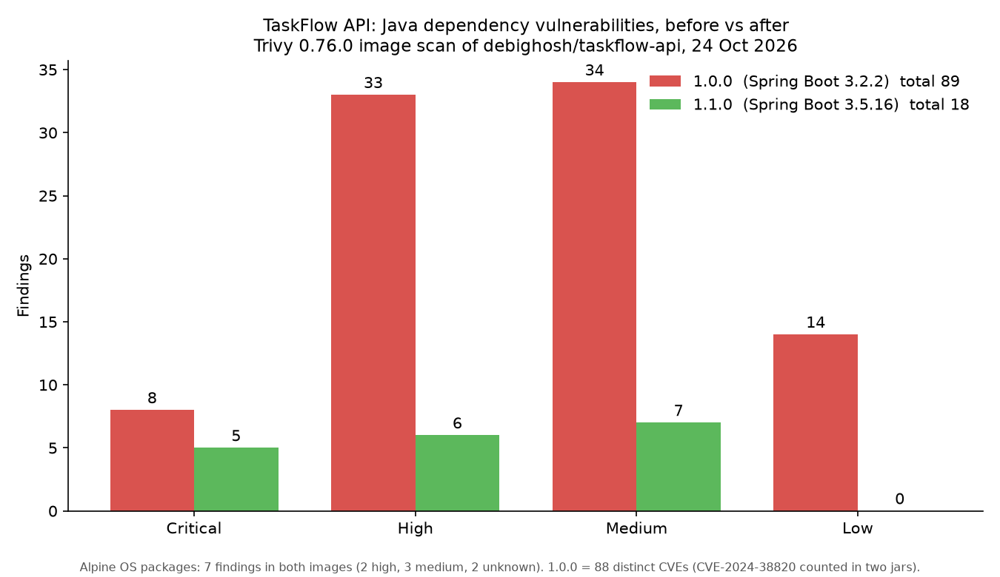

# TaskFlow API — Module 4 submission

Module 4 (Dockerize & Deploy) for the TaskFlow API. The mandatory tasks are done: a multi-stage Dockerfile, a local image build, and a live deploy on Railway. Stretch goals 1, 2, 4, and 5 are done. Option 3 was not attempted.

This file is the submission. Operator detail (CircleCI variables, the release order, and the Railway variable reference) is in [docs/DEVOPS.md](docs/DEVOPS.md).

## Live application

| | |
| --- | --- |
| API | https://module3-taskflow-api-production-d562.up.railway.app |
| Task list | https://module3-taskflow-api-production-d562.up.railway.app/api/tasks |
| Frontend | https://module4-task-manager.netlify.app |
| Frontend repository | https://github.com/debighosh/task-manager |
| This repository | https://github.com/debighosh/module3-taskflow-api |
| Image | https://hub.docker.com/r/debighosh/taskflow-api/tags |

Checked on 24 October 2026:

- `GET /api/tasks` returned **200** and a JSON array. The body had eight tasks. Ids 1–6 are the six tasks the API inserts when the table is empty. Ids 8 and 9 (`Deployed from Railway`, `Testing the Task creation 24-Oct-2026`) were created afterwards. Postgres keeps those rows across restarts.
- An `OPTIONS` preflight from `Origin: https://module4-task-manager.netlify.app` returned **200** with `access-control-allow-origin: https://module4-task-manager.netlify.app` and `access-control-allow-methods: GET,POST,PUT,DELETE,OPTIONS`.
- CRUD from the Netlify site was confirmed in the browser. The screenshot of that page is still to be added ([checklist](#screenshots-still-to-add)).

## Architecture

Two GitHub repositories. CircleCI publishes the API image. Railway builds the API from this repo's Dockerfile and runs Postgres beside it. Netlify builds the separate frontend, and the browser calls the Railway API.



Railway does not pull the Docker Hub image. A push to `main` builds the image in CircleCI and, separately, Railway rebuilds from the Dockerfile.

## Mandatory tasks

| Task | Result |
| --- | --- |
| 1. Dockerfile | Multi-stage build in the repository root. Build stage `maven:3.9-eclipse-temurin-21`, runtime stage `eclipse-temurin:21-jre-alpine`, process listens on 8080. The runtime process runs as user `taskflow`, and the image carries an OCI version label. |
| 2. Local image | `docker build` / `docker run` / `curl` in [Run the image locally](#run-the-image-locally). |
| 3. Railway | API service plus a Postgres service. Public domain on port 8080. Railway builds from the Dockerfile on pushes to `main`. |
| 4. Verify | Live `GET /api/tasks` returns 200. Dashboard and curl screenshots are listed under [Screenshots](#screenshots). |

## Stretch goals

| Option | Result |
| --- | --- |
| 1. CI to Docker Hub | CircleCI workflow `test`, `dependency-check`, `docker-image`. Images go to `debighosh/taskflow-api` on pushes to `main`. Credentials are CircleCI project variables, not files in git. |
| 2. Frontend on Netlify | https://module4-task-manager.netlify.app calls the Railway API. `ALLOWED_ORIGINS` is that Netlify origin. |
| 3. Simple CRM | Not attempted. This submission is the TaskFlow API. |
| 4. Versioned images | `1.0.0`, `1.1.0`, `sha-<12 character commit>`, and `latest`. Scheme in [Image tags](#image-tags). |
| 5. Security checks | Trivy 0.76.0 on the dependency jars and on the image, in CI and again for the numbers below. OWASP Dependency-Check runs only when `NVD_API_KEY` is set. No passwords, tokens, or API keys are committed. |

Successful CircleCI jobs for the published commits (GitHub commit statuses):

- `1.1.0`, commit [`4263e0d815b7`](https://github.com/debighosh/module3-taskflow-api/commit/4263e0d815b7) (merge of [PR #2](https://github.com/debighosh/module3-taskflow-api/pull/2)): [test](https://circleci.com/gh/debighosh/module3-taskflow-api/13), [dependency-check](https://circleci.com/gh/debighosh/module3-taskflow-api/14), [docker-image](https://circleci.com/gh/debighosh/module3-taskflow-api/15)
- `1.0.0`, commit [`fb1313e1d721`](https://github.com/debighosh/module3-taskflow-api/commit/fb1313e1d721) (merge of [PR #1](https://github.com/debighosh/module3-taskflow-api/pull/1)): [test](https://circleci.com/gh/debighosh/module3-taskflow-api/7), [docker-image](https://circleci.com/gh/debighosh/module3-taskflow-api/8), [dependency-check](https://circleci.com/gh/debighosh/module3-taskflow-api/9)

Docker Hub tags: https://hub.docker.com/r/debighosh/taskflow-api/tags

## Application

<!-- LINUS:APP-SECTION
Replace the placeholder below. Keep this comment until the section is written.
Add:
- API endpoints with sample requests
- H2 (default) profile versus the prod profile
- CORS and frontend notes
- How to run the tests
-->

**Placeholder for Linus.** This section is empty on purpose. Add it on this pull request:

- API endpoints, with sample requests
- how the default H2 profile differs from the `prod` profile
- CORS and frontend notes
- how to run the tests

Deployed variable values, the Netlify origin, and the preflight check are under [Railway and Netlify](#railway-and-netlify). Local Docker commands are under [Run the image locally](#run-the-image-locally).

## Run the image locally

From the repository root. The first build downloads Maven dependencies.

```bash
docker build -t taskflow:latest .
docker run --rm -p 8080:8080 taskflow:latest
```

In a second terminal:

```bash
curl http://localhost:8080/api/tasks
```

Stop the container with Ctrl-C in the `docker run` terminal, or `docker stop` on the container id from `docker ps`.

The container listens on 8080. `PORT` is unset, which is the local case. The image tag `taskflow:latest` is only the local name. Published tags are described below and in [docs/DEVOPS.md](docs/DEVOPS.md).

## CI/CD pipeline

Config: [`.circleci/config.yml`](.circleci/config.yml). How to set the variables is in [docs/DEVOPS.md](docs/DEVOPS.md).

Workflow `ci` runs on every branch push:

1. `test` — `mvn test` on the default profile and the in-memory H2 database.
2. `dependency-check` — in parallel with the tests. Trivy 0.76.0 `rootfs` scan of the runtime jars. OWASP Dependency-Check 13.0.0 only when `NVD_API_KEY` is non-empty.
3. `docker-image` — after `test`. Builds the image, scans it with Trivy 0.76.0, and pushes only from `main` (or from a `vMAJOR.MINOR.PATCH` git tag).

`docker-image` does not wait for `dependency-check`. Scan findings use `--exit-code 0`, so a CVE does not fail the publish. Reports are CircleCI artifacts (`trivy-dependencies.txt`, `trivy-image.txt`).

Required CircleCI project variables for a publish: `DOCKERHUB_USERNAME` (`debighosh`) and `DOCKERHUB_TOKEN`. `NVD_API_KEY` is optional and is unset.

### Image tags

`VERSION` in the repository root is `MAJOR.MINOR.PATCH` with no `v` prefix. It is `1.1.0` on `main`. The Maven version in `pom.xml` stays `0.0.1-SNAPSHOT`. Image tags follow `VERSION`, not the pom.

On a push to `main`, CircleCI pushes:

| Tag | Moves when |
| --- | --- |
| `debighosh/taskflow-api:<VERSION>` | That version is published. Publishing the same version again moves the tag. |
| `debighosh/taskflow-api:sha-<12 character commit>` | Every publish. The suffix is `git rev-parse --short=12 HEAD`. |
| `debighosh/taskflow-api:latest` | A push to `main` only. A version-tag pipeline does not move it. |

Tags on Docker Hub, read from the public registry on 24 October 2026:

| Tag | Git commit | OCI version label | Contents | Published (UTC) | Digest |
| --- | --- | --- | --- | --- | --- |
| `1.0.0`, `sha-fb1313e1d721` | `fb1313e1d721` ([PR #1](https://github.com/debighosh/module3-taskflow-api/pull/1)) | `1.0.0` | Spring Boot 3.2.2. Runtime jar `spring-boot-3.2.2.jar`, Tomcat 10.1.18, Jackson 2.15.3. 56 jars under `BOOT-INF/lib`. | 2026-10-19 06:27 | `sha256:c46f194ce944b73e64c41901017ae15345715cfd78ce276726051c43213799ff` |
| `1.1.0`, `sha-4263e0d815b7`, `latest` | `4263e0d815b7` ([PR #2](https://github.com/debighosh/module3-taskflow-api/pull/2)) | `1.1.0` | Spring Boot 3.5.16. Runtime jar `spring-boot-3.5.16.jar`, Tomcat 10.1.55, Jackson 2.21.4, PostgreSQL driver 42.7.11. 57 jars under `BOOT-INF/lib`. | 2026-10-19 08:10 | `sha256:b161a48a07fff1e5e052f5106a985b85e87f3e7f31feaab7b7656bb0be0cad7d` |

`latest` and `sha-4263e0d815b7` are the same digest as `1.1.0`. `1.0.0` was left on the Spring Boot 3.2.2 image. See [error 5](#5-version-bump-before-the-1-1-0-merge).

## Railway and Netlify

Railway project: one API service, built from this repository's Dockerfile, and one Postgres service.

API service settings:

| Variable | Value |
| --- | --- |
| `SPRING_PROFILES_ACTIVE` | `prod` |
| `PGHOST`, `PGPORT`, `PGDATABASE`, `PGUSER`, `PGPASSWORD` | References to the Postgres service (`${{Postgres.*}}`). The values are not in git. |
| `ALLOWED_ORIGINS` | `https://module4-task-manager.netlify.app` |
| Public networking | Generated domain, port **8080** |

`application-prod.properties` builds a JDBC URL from those `PG*` variables. Railway's `DATABASE_URL` is not a JDBC URL. The process listens on `PORT` when Railway sets it, and on 8080 otherwise. The generated domain is pointed at 8080.

The frontend is a separate React/Vite repository, [debighosh/task-manager](https://github.com/debighosh/task-manager), deployed on Netlify. `VITE_API_URL` is the Railway origin, set at Netlify build time:

`https://module3-taskflow-api-production-d562.up.railway.app`

## Security scans (option 5)

Rescanned on **24 October 2026** with **Trivy 0.76.0** (the version CI installs). Both images were pulled from Docker Hub.

| Database | Version | UpdatedAt (UTC) | DownloadedAt (UTC) |
| --- | --- | --- | --- |
| Vulnerability DB | 2 | 2026-10-24 01:18:19 | 2026-10-24 03:37:13 |
| Java DB | 1 | 2026-10-24 01:07:32 | 2026-10-24 03:37:28 |

Method:

- Image: `trivy image` on `debighosh/taskflow-api:1.0.0` and `:1.1.0`, severities `UNKNOWN,LOW,MEDIUM,HIGH,CRITICAL`. Trivy prints one total per target. The default image scan also runs the secret scanner: **0 secrets** in either image.
- Runtime jars: exported `/app/app.jar`, unpacked `BOOT-INF/lib`, then `trivy rootfs --scanners vuln` on that directory. `trivy fs` does not open JARs. This matches the CI `dependency-check` job, which scans Maven runtime jars the same way.

The Java totals from `trivy image` and from `trivy rootfs` are the same. Alpine packages appear only in the image scan. Both images are Alpine 3.24.2, and the Alpine totals match.

### Before / after

Counts are Trivy `Total` lines (one row per package and vulnerability). `1.0.0` is Spring Boot 3.2.2. `1.1.0` is Spring Boot 3.5.16.

| Target | 1.0.0 total | 1.0.0 by severity | 1.1.0 total | 1.1.0 by severity |
| --- | --- | --- | --- | --- |
| Alpine packages in the image | 7 | 0 critical, 2 high, 3 medium, 0 low, 2 unknown | 7 | 0 critical, 2 high, 3 medium, 0 low, 2 unknown |
| Java dependencies (`trivy image` and `trivy rootfs`) | 89 | 8 critical, 33 high, 34 medium, 14 low | 18 | 5 critical, 6 high, 7 medium, 0 low |

Distinct vulnerability IDs on the 1.0.0 jars: **88** (8 critical, 33 high, 33 medium, 14 low). The table total is 89 because `CVE-2024-38820` is reported twice, for `spring-context` 6.1.3 and for `spring-web` 6.1.3. The figure of 88 recorded from the earlier jar scan is that distinct-ID count. This table uses Trivy's totals so both versions are counted the same way, against the database dated above.

Of the 89 jar rows on 1.0.0, 75 are absent on 1.1.0. Four rows are new on 1.1.0:

| Severity | ID | Package on 1.1.0 | Why it is new |
| --- | --- | --- | --- |
| Critical | CVE-2026-47890 | `spring-webmvc` 6.2.19 | Present after the Spring upgrade. Fix listed as 7.0.9. |
| High | CVE-2026-54291 | `postgresql` 42.7.11 | The PostgreSQL driver is in the 1.1.0 image (prod profile). It is not in the 1.0.0 image. Fix listed as 42.7.12. |
| High | CVE-2026-89407 | `jackson-core` 2.21.4 | Applies to the upgraded Jackson line. |
| Medium | GHSA-mhm7-754m-9p8w | `jackson-databind` 2.21.4 | Applies to the upgraded Jackson line. |

Package rows that dropped the most: `tomcat-embed-core` 35 → 3 (10.1.18 → 10.1.55), `spring-webmvc` 15 → 2 (6.1.3 → 6.2.19), `logback-core` 6 → 0 (1.4.14 → 1.5.34).

### What is still reported, and why it was left

The upgrade in [PR #2](https://github.com/debighosh/module3-taskflow-api/pull/2) is Spring Boot 3.2.2 to 3.5.16. That is the dependency change this submission makes. Findings do not fail the CircleCI job.

Java findings still on 1.1.0, all with a fixed version newer than the Spring Boot 3.5.16 set:

| Package | Installed | Findings | Fixed version in the advisory |
| --- | --- | --- | --- |
| `tomcat-embed-core` | 10.1.55 | 3 critical (CVE-2026-65182, CVE-2026-65905, CVE-2026-68525) | 10.1.58 (also 11.0.25, 9.0.121) |
| `spring-webmvc` | 6.2.19 | 2 critical (CVE-2026-47884, CVE-2026-47890) | 7.0.9 |
| `jackson-databind` | 2.21.4 | 3 high, 6 medium | 2.21.5–2.21.7, depending on the advisory |
| `jackson-core` | 2.21.4 | 2 high | 2.21.7 |
| `postgresql` | 42.7.11 | 1 high (CVE-2026-54291) | 42.7.12 |
| `log4j-api` | 2.24.3 | 1 medium (CVE-2026-49844) | 2.25.5 or 2.26.1 |

Spring Framework 7.0.9 is a new major line. It was not applied on top of Spring Boot 3.5.16. The Tomcat, Jackson, PostgreSQL, and Log4j fixes were left on the versions Boot 3.5.16 manages.

Alpine findings are the same on both tags. They come from `eclipse-temurin:21-jre-alpine`, the runtime base in the assignment Dockerfile. Both published images are Alpine 3.24.2. The base image tag was not changed.

| Severity | ID | Package | Installed | Fixed |
| --- | --- | --- | --- | --- |
| High | CVE-2026-111497 | `brotli-libs` | 1.2.0-r1 | 1.2.1-r0 |
| High | CVE-2026-77214 | `libexpat` | 2.8.5-r0 | 2.9.0-r0 |
| Medium | CVE-2026-102633 | `libexpat` | 2.8.5-r0 | 2.9.0-r0 |
| Medium | CVE-2026-46675 | `libpng` | 1.6.58-r1 | 1.6.59-r0 |
| Medium | CVE-2026-85091 | `zlib` | 1.3.2-r0 | 1.3.2-r1 |
| Unknown | CVE-2026-107891 | `musl`, `musl-utils` | 1.2.6-r2 | 1.2.6-r3 |

`CVE-2026-107891` is severity **unknown**. Trivy 0.76.0 logged that it has no vulnerability details and that the CVE may be rejected. It is still counted in the Alpine total of 7.

OWASP Dependency-Check has no finding count in this submission. CI skips version 13.0.0 when `NVD_API_KEY` is blank, because that release exits 13 with no key ([error 1](#1-owasp-dependency-check-exits-13-without-an-nvd-key)). The jar numbers above are the Trivy scan CI stores as `trivy-dependencies.txt`.

No Docker Hub token, NVD API key, or Postgres password is in the repository. The token and the optional NVD key are CircleCI project variables. The database password is a Railway reference to the Postgres service.

## Errors encountered

The mandatory tasks and stretch goals 1, 2, 4, and 5 completed. These failed on the way and were fixed, except option 3, which was left out.

### 1. OWASP Dependency-Check exits 13 without an NVD key

Dependency-Check 13.0.0 exited 13: `NvdApiException: Invalid API Key, length of 0 too short`, then `Unable to continue dependency-check analysis`, because no NVD documents were downloaded. The CLI ships with an empty `nvd.api.key`. The request form at the NVD key site hung, so there was no key to store. Upstream report: [dependency-check issue 8715](https://github.com/dependency-check/DependencyCheck/issues/8715). The fix is merged upstream and is not in 13.0.0, which was still the latest release.

Fix in CI: if `NVD_API_KEY` is blank, the job writes `SKIPPED.txt`, exits 0, and does not run Dependency-Check. The same job still scans the runtime jars with `trivy rootfs` (no NVD key). `trivy fs` does not open JARs, so `rootfs` is the scanner that actually reads them.

### 2. Re-running a CircleCI pipeline rebuilt the old commit

A pipeline rerun replayed the commit from before the Dependency-Check fix, so the red job came back.

Fix: a CircleCI rerun builds the original commit. The fix has to be a new pipeline on `main`, not a rerun of the failed one.

### 3. Railway could not see the GitHub repository

Railway showed `Could not load branches`, and the repository search showed `No results found`. Signing in to Railway with GitHub had not installed the Railway GitHub App.

Fix: install the Railway GitHub App and grant it access to this repository. The repo and its branches then appeared, and the Dockerfile deploy could be created.

### 4. CORS preflight returned 403 until the variable was deployed

The browser blocked the Netlify origin. `OPTIONS` from `https://module4-task-manager.netlify.app` returned **403** while `ALLOWED_ORIGINS` was only staged in Railway. Railway keeps variable edits staged until **Deploy** is clicked.

Fix: deploy the staged variable `ALLOWED_ORIGINS=https://module4-task-manager.netlify.app`. The same preflight then returned **200** with `access-control-allow-origin` set to that origin. Rechecked on 24 October 2026; still 200.

### 5. Version bump before the 1.1.0 merge

`VERSION` was set to `1.1.0` on PR #2 before that pull request merged. A merge that still contained `1.0.0` would have pushed Spring Boot 3.5.16 onto the tag `1.0.0` and replaced the 3.2.2 baseline. The `sha-` tag of the old build would have survived, but the semver tag would not.

The merge commit `4263e0d815b7` contains `1.1.0`. Docker Hub still has both digests: `1.0.0` is Spring Boot 3.2.2, and `1.1.0` / `latest` are Spring Boot 3.5.16.

## Screenshots

DG will add these files under `docs/screenshots/`. Until then the images below do not resolve. No placeholder binaries are in the repository.



Railway project: API service and Postgres service, with the API deployment active.



Deploy logs for a successful Railway build from the repository Dockerfile.



`curl` of `GET /api/tasks` on the Railway URL, HTTP 200 and task JSON.



`curl` of `POST /api/tasks` on the Railway URL, creating a task.



A green CircleCI workflow on `main`: `test`, `dependency-check`, and `docker-image`.



Docker Hub tags for `debighosh/taskflow-api`: `1.0.0`, `1.1.0`, `sha-fb1313e1d721`, `sha-4263e0d815b7`, and `latest`.



https://module4-task-manager.netlify.app in the browser, showing tasks loaded from the Railway API.



Trivy output for `1.0.0` and `1.1.0` (image scan or the runtime-jar scan). The counts are in [Before / after](#before--after).

## Screenshots still to add

- [ ] `docs/screenshots/railway-services.png` — Railway dashboard, API and Postgres, deployment active
- [ ] `docs/screenshots/railway-deploy-logs.png` — successful Railway build log
- [ ] `docs/screenshots/curl-get.png` — live `GET /api/tasks` returning 200
- [ ] `docs/screenshots/curl-post.png` — live `POST /api/tasks`
- [ ] `docs/screenshots/circleci-pipeline.png` — green CircleCI workflow on `main`
- [ ] `docs/screenshots/dockerhub-tags.png` — Docker Hub tags, including `1.0.0`, `1.1.0`, and `latest`
- [ ] `docs/screenshots/netlify-app.png` — Netlify frontend showing API data
- [ ] `docs/screenshots/trivy-before-after.png` — Trivy before/after for 1.0.0 and 1.1.0
